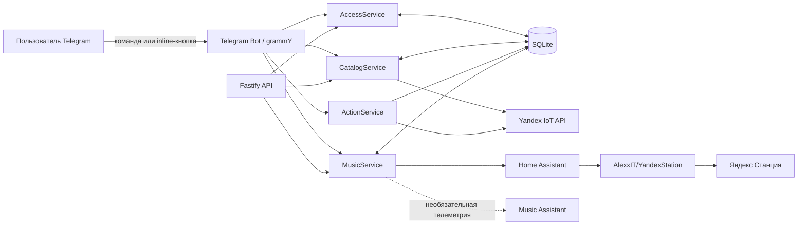

# Архитектура Yandex Home Remote

## Короткое объяснение проекта

Yandex Home Remote — локальный Telegram-пульт для личного умного дома Яндекса. Пользователь пишет боту или нажимает inline-кнопку, backend проверяет его права и корректность команды, а затем направляет действие либо в официальный Yandex IoT API, либо в локальный Home Assistant для управления Яндекс Станцией.

Проект не является облачной платформой производителя устройств. Это персональный локальный сервис: он работает на компьютере владельца в Docker, не требует белого IP и получает команды из Telegram через long polling.

Главная архитектурная идея — отделить интерфейс, бизнес-правила и внешние интеграции. Telegram ничего не знает о протоколах Яндекса, а клиенты Яндекса и Home Assistant ничего не знают о кнопках бота.

## Схема системы



## Из каких частей состоит проект

### 1. Telegram Bot

Файл: `src/bot/bot.ts`.

Это пользовательский интерфейс. Он:

- обрабатывает `/start`, `/sync`, музыкальные команды и inline-кнопки;
- показывает устройства, сценарии, музыку, громкость и админский раздел;
- регистрирует новых пользователей и создаёт заявки на доступ;
- передаёт работу сервисам, но сам не обращается напрямую к Яндексу или SQLite.

Бот работает через Telegram long polling, поэтому входящий порт из интернета не нужен.

### 2. Core-сервисы

Core содержит бизнес-логику, не зависящую от интерфейса:

- `AccessService` — проверяет владельца и выданные пользователям права;
- `CatalogService` — получает каталог умного дома, нормализует его и хранит последнюю версию в SQLite;
- `ActionService` — валидирует capability устройства, повторно проверяет актуальное состояние и последовательно выполняет команды одному target;
- `MusicService` — выбирает колонку, управляет громкостью, музыкой, TTS, командами Алисе и локальной музыкальной очередью.

Такое разделение позволяет позже добавить второй интерфейс, например web-панель, не переписывая управление устройствами.

### 3. Адаптеры внешних систем

В `src/integrations` находятся клиенты внешних API:

- `YandexIotClient` использует официальный пользовательский Yandex IoT API для каталога, устройств и авторских сценариев;
- `HomeAssistantClient` вызывает сервисы `media_player` для выбранной Яндекс Станции;
- `MusicAssistantClient` используется как необязательный источник состояния плеера. Он больше не является исполнительным контуром и не выбирает, какой трек должен заиграть.

Home Assistant нужен потому, что официальный пользовательский IoT API не предоставляет достаточного публичного контракта для полноценного управления аудиоплеером Станции.

### 4. SQLite

SQLite — локальное состояние приложения. Основные таблицы:

- `app_state` — кеш каталога Яндекс.Дома;
- `bot_users` — известные Telegram-пользователи и признак доступа;
- `access_requests` — заявки со статусами `PENDING`, `APPROVED`, `REJECTED`;
- `bot_callbacks` — одноразовые inline-действия, привязанные к пользователю и TTL;
- `action_log` — журнал команд без OAuth- и Telegram-токенов;
- `music_queue` — запросы треков и их состояния `QUEUED`, `PLAYING`, `DONE`, `FAILED`, `CLEARED`.

В Docker база лежит в именованном volume `home-remote-data`, поэтому переживает пересборку контейнера и `docker compose down` без флага `-v`.

### 5. Fastify API

Fastify предоставляет локальный `/health` и защищённый `/api/catalog`. Сейчас это служебный интерфейс для диагностики и возможного будущего web-клиента. Он слушает только `127.0.0.1`, то есть наружу не публикуется.

## Два контура управления

### Устройства и авторские сценарии

```text
Telegram → Bot → AccessService → Catalog/ActionService → Yandex IoT API → устройство
```

Перед выполнением действия backend заново проверяет пользователя, target, capability и допустимое значение. Команды одному устройству сериализуются, чтобы два быстрых нажатия не создавали гонку.

### Музыка и голосовые функции

```text
Telegram → Bot → MusicService → Home Assistant → YandexStation → колонка
```

Название трека превращается в команду Алисе вида «Включи песню ...». Громкость, `Play` и `Pause` вызывают соответствующие сервисы `media_player`. TTS передаётся как текст, а погода, новости, будильники и другие базовые функции — как голосовые команды Алисе.

SQLite хранит намерение пользователя и порядок запросов, но не считается источником истины о том, что физически играет. Фактическое название показывается только при наличии внешней телеметрии. Если колонка сообщает лишь `playing` без названия, бот пишет «нет данных от колонки».

Автопереход к следующему запросу консервативный: раз в пять секунд проверяется состояние, но переключение разрешено только после подтверждённого `idle` и защитной паузы после команды. Это сделано, чтобы бот не прерывал играющий трек из-за неполных данных.

## Как проходит нажатие inline-кнопки

1. При построении меню bot сохраняет в SQLite короткий callback ID, actor ID, payload и срок действия.
2. Telegram получает только короткий callback ID.
3. При нажатии callback атомарно читается и удаляется.
4. Проверяется, что кнопку нажал тот же пользователь и TTL не истёк.
5. AccessService повторно проверяет право пользователя.
6. Core-сервис валидирует target и действие.
7. Интеграционный клиент выполняет запрос во внешнюю систему.
8. Результат сохраняется в журнал или очередь, а пользователь получает ответ.

Поэтому старую кнопку нельзя использовать повторно или переслать другому пользователю для выполнения команды.

## Доступ пользователей

Владелец определяется переменной `OWNER_TELEGRAM_ID` и всегда имеет доступ. Остальные пользователи сначала вызывают `/start`; бот сохраняет профиль и заявку. Владелец принимает или отклоняет её в админском меню. После принятия `authorized` пользователя становится равным `1`.

Пользователю выдаётся гостевой доступ, но не роль администратора. Гость может только добавлять песни, просматривать очередь и устанавливать громкость `1–6`. Устройства, сценарии, выбор колонки, TTS, управление воспроизведением, переключение и очистка очереди остаются доступны только владельцу. Ограничение действует не только на видимость кнопок: backend отклоняет старые callback и прямые команды гостя.

Для обычных авторизованных пользователей громкость ограничена уровнями `1–6`. Владелец сохраняет полный диапазон `0–10`. Проверка выполняется и при построении интерфейса, и перед исполнением команды, поэтому старый callback или ручной `/volume` не обходят правило.

## Docker-топология

Compose запускает три постоянных сервиса и один установочный контейнер:

- `app` — TypeScript/Node.js backend, Telegram Bot и Fastify;
- `homeassistant` — локальный Home Assistant;
- `music-assistant` — необязательная телеметрия плеера;
- `yandex-station-installer` — одноразово устанавливает интеграцию AlexxIT/YandexStation в volume Home Assistant.

Секреты передаются контейнеру `app` из локального `.env`. Сам `.env` исключён из Git и Docker build context. В репозитории должен находиться только безопасный шаблон `.env.example` с пустыми значениями.

## Границы и известные ограничения

- Название и длительность текущего трека не всегда доступны через Home Assistant/YandexStation.
- Из-за этого локальная очередь не может гарантировать идеальный автоматический переход после естественного конца каждого трека.
- Music Assistant показал нестабильное воспроизведение некоторых треков Yandex Music и больше не управляет звуком.
- Выбранная колонка сейчас хранится в памяти процесса, а не отдельно для каждого пользователя.
- Fastify API пока не является полноценной web-панелью.

## Как объяснить архитектуру за минуту

«Это локальный Telegram-пульт для Яндекс.Дома. Telegram — только интерфейс. Внутри Node.js backend разделён на сервисы доступа, каталога, действий и музыки. Обычные устройства и сценарии управляются через официальный Yandex IoT API, а колонка — через локальный Home Assistant с интеграцией YandexStation. SQLite хранит пользователей, заявки, безопасные callback-кнопки, журнал и музыкальную очередь. Всё запускается Docker Compose на компьютере владельца; наружу порты управления не открываются, а секреты лежат только в локальном `.env`. Music Assistant оставлен лишь для необязательной телеметрии, потому что как исполнитель очереди он оказался нестабилен».
